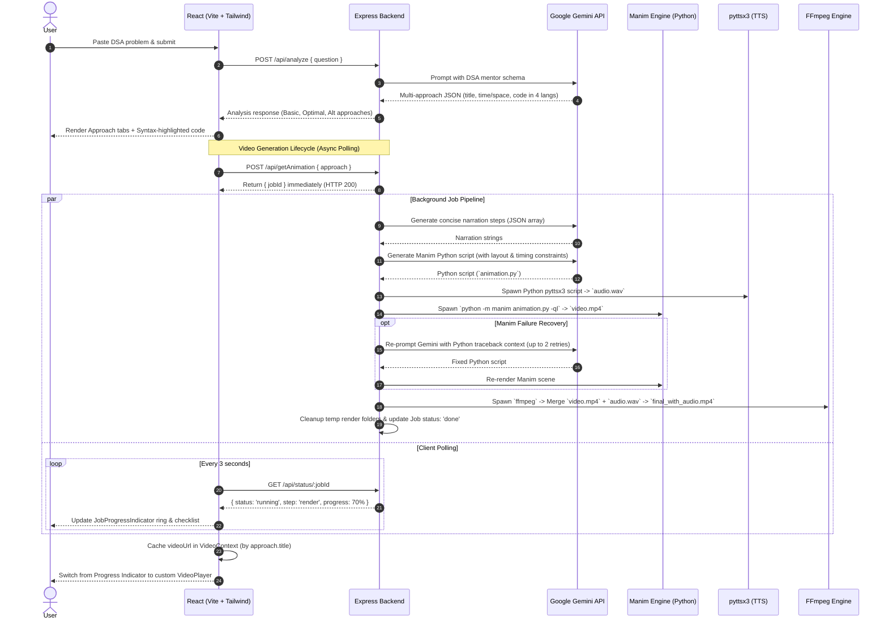

# Code2Concept: System Architecture & Technical Documentation

**Code2Concept** is an AI-powered educational multimedia platform that transforms raw Data Structures and Algorithms (DSA) problem statements into comprehensive written explanations, multi-language solutions, and synchronized mathematical animation videos with voice narration.

---

## 1. High-Level Architecture & End-to-End Workflow



---

## 2. Deep-Dive: Core Subsystems

### A. Frontend Architecture (React 19 + Vite + Tailwind CSS + Motion)
1. **State Isolation & Caching**:
   - `AppContext`: Manages page state (`home` vs `explanation`), problem submission lifecycle, and error boundaries.
   - `VideoContext`: Maps `approachTitle -> videoUrl` and `approachTitle -> jobId`. Switching tabs between different solution approaches never duplicates rendering jobs—if a job is in-flight, it smoothly resumes polling; if completed, it instantly loads the cached video without network overhead.
2. **Component Separation**:
   - `JobProgressIndicator`: Displays a 5-stage SVG radial progress indicator and live checklist (`narration` → `script` → `audio` → `render` → `merge`).
   - `VideoPlayer`: Extracted presentational video player supporting keyboard shortcuts (`Space` = Play/Pause, `←`/`→` = Seek ±10s, `M` = Mute, `F` = Fullscreen) with auto-hiding controls.
   - `ExplanationSection`: Syntax-highlighted code viewer using `highlight.js` (Atom One Dark theme) supporting Java, Python, C++, and JavaScript.
3. **Resilience**:
   - Wrapped in a React Class-Based `ErrorBoundary` that captures unhandled render crashes with a fallback recovery UI.

---

### B. Backend Architecture & Media Generation Pipeline (Node.js + Express)
1. **Asynchronous Non-Blocking Job Queue**:
   - Manim rendering and video encoding take between 30 to 120 seconds. Traditional synchronous HTTP requests result in gateway timeouts (HTTP 504) on production proxies (Cloudflare, Vercel, Railway).
   - The backend converts rendering into an async background task: returns an immediate UUID `jobId` and exposes a status polling route `/api/status/:jobId`.
2. **Self-Healing AI-Code Loop (Manim Auto-Retry)**:
   - If Manim execution returns a non-zero exit code (e.g., Python syntax errors, layout collisions, or coordinate errors), the error traceback is captured and injected back into a specialized Gemini prompt. Gemini fixes the code with context, achieving a significantly higher final render success rate.
3. **Rate-Limit Resilience (Exponential Backoff)**:
   - `withGeminiRetry()` wrapper intercepts HTTP 429 errors from Google Gemini, parses the dynamic `retry in Xs` header, and applies exponential backoff with jitter to stay within free-tier quotas.
4. **Environment Auto-Discovery**:
   - On startup, the server inspects the WinGet package repository and dynamically adds FFmpeg binaries to `process.env.PATH`, ensuring seamless execution across both direct FFmpeg spawns and Manim subprocesses.
5. **Disk & Memory Hygiene**:
   - Temporary frames, narration scripts, and intermediate `.wav` files are wiped immediately upon job completion. An automated cron cleans in-memory jobs older than 1 hour.

---

## 3. API Reference & Contract Specification

### 1. `POST /api/analyze`
Analyzes a submitted DSA problem and generates structured solution approaches.
* **Request Body**:
  ```json
  {
    "question": "Two Sum: Given an array of integers nums and an integer target..."
  }
  ```
* **Response (HTTP 200)**:
  ```json
  {
    "question": "Two Sum...",
    "title": "Problem Analysis",
    "approaches": [
      {
        "title": "Hash Map Approach",
        "timeComplexity": "O(n)",
        "spaceComplexity": "O(n)",
        "description": "Store seen elements in a hash map to find complements in linear time.",
        "code": {
          "javaCode": "public int[] twoSum...",
          "pythonCode": "def twoSum...",
          "cppCode": "vector<int> twoSum...",
          "jsCode": "function twoSum..."
        },
        "pros": ["O(n) linear time complexity", "Single pass"],
        "cons": ["O(n) auxiliary space"],
        "concepts": ["Hash Table", "Complement Lookup"]
      }
    ]
  }
  ```

### 2. `POST /api/getAnimation`
Enqueues an asynchronous video generation job for a chosen approach.
* **Request Body**:
  ```json
  {
    "approach": {
      "title": "Hash Map Approach",
      "code": { "javaCode": "..." }
    }
  }
  ```
* **Response (HTTP 200)**:
  ```json
  {
    "jobId": "8cfc01d2-0ac9-4e39-8dae-acd8b2ac21d4"
  }
  ```

### 3. `GET /api/status/:jobId`
Polls the execution state and progress of an active generation job.
* **Response (In-Progress)**:
  ```json
  {
    "status": "running",
    "step": "render",
    "stepLabel": "Rendering animation frames…",
    "progress": 70,
    "videoUrl": null,
    "error": null
  }
  ```
* **Response (Completed)**:
  ```json
  {
    "status": "done",
    "step": "done",
    "stepLabel": "Complete!",
    "progress": 100,
    "videoUrl": "http://localhost:5000/videos/8cfc01d2.../animation_with_audio.mp4",
    "error": null
  }
  ```

---

## 4. Production Scaling Roadmap (Future Enhancements)

If asked in an interview how you would scale this application to 100,000+ daily active users:

1. **Distributed Task Queue (Redis + BullMQ / Celery)**:
   - Replace the in-memory `Map` job queue with Redis-backed BullMQ (Node.js) or Celery (Python).
   - Offload heavy Manim and FFmpeg worker processes onto autoscaling container pools (AWS ECS / Kubernetes / Google Cloud Run) dedicated solely to GPU/CPU-bound video rendering.
2. **Real-Time Push (WebSockets / Server-Sent Events)**:
   - Replace 3-second HTTP polling with SSE (Server-Sent Events) or Socket.io to push real-time step and frame progress directly to the client.
3. **Cloud Object Storage & CDN (AWS S3 + CloudFront)**:
   - Upload completed MP4 videos and generated subtitles directly to S3 / Google Cloud Storage and deliver via CloudFront CDN with signed URLs, removing media serving load from Express.
4. **Result Caching (PostgreSQL / DynamoDB)**:
   - Hash the problem text (e.g. SHA-256) to cache both the LLM analysis and pre-rendered approach videos, serving instant responses for frequently searched problems like "Two Sum" or "LRU Cache".
